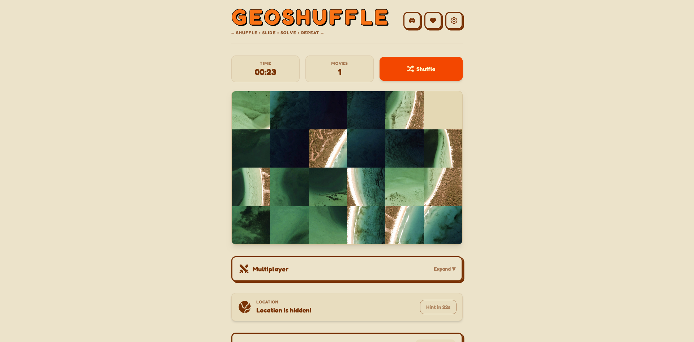
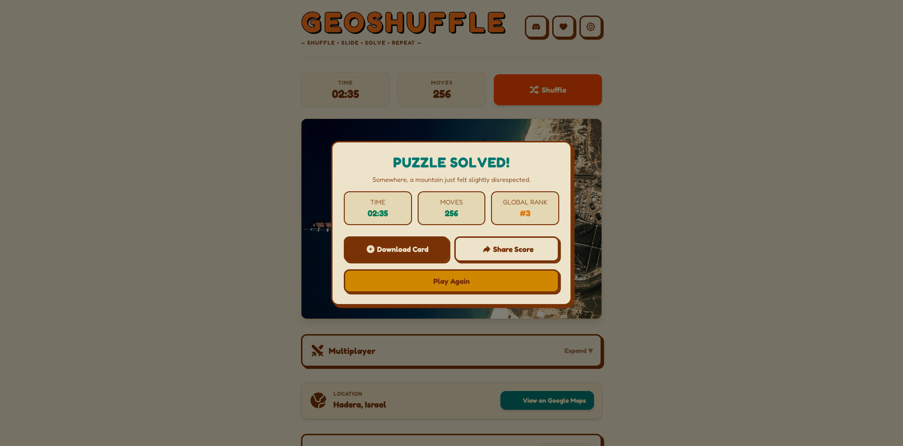
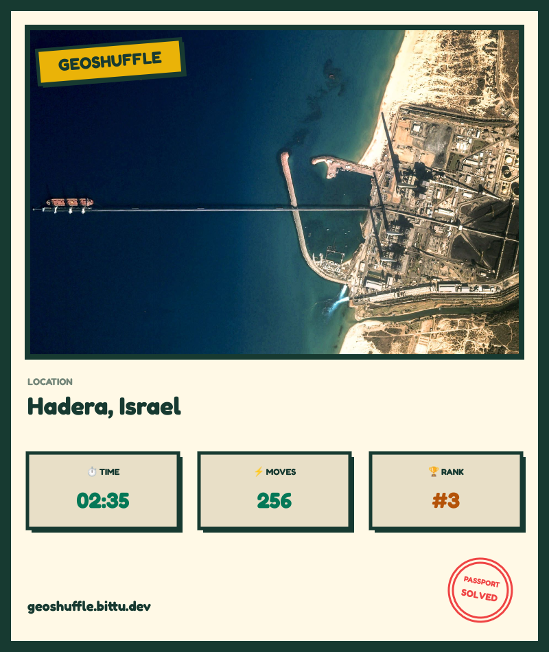

<div align="center">


# Geo · Shuffle

### **A sliding puzzle of satellite imagery with P2P multiplayer.**  
### [Play now at geoshuffle.bittu.dev](https://geoshuffle.bittu.dev)

<br>



<br>

</div>

## How To Play

- Every match scrambles a satellite view of a landmark on Earth.
- Slide tiles into the empty space to reconstruct the complete satellite photo.
- Hints unlock after 45 seconds if you're stuck.
- Minimize your move count to rank higher.
- Complete the puzzle to reveal the location, and get a scorecard.


## Controls

- Slide tiles using `W` `A` `S` `D` or `Arrow` keys.
- Click or tap any tile along the row or column of the gap to slide it.
- Swipe across the puzzle grid on touchscreens and mobile devices.


## Game Modes

The game supports both Singleplayer and Multiplayer (using [PeerBasket](https://peerbasket.bittu.dev/)).

## Scorecards & Leaderboards

<div align="center">
  
  &nbsp;&nbsp;
  
</div>

<br>

## Other Features

- **Global Leaderboard**: Uses Supabase for it.
- **Scorecards**: Generated on the client side.
- **P2P Multiplayer**: Uses WebRTC, PeerJS and [PeerBasket](https://peerbasket.bittu.dev/) to directly connect two browsers to enable Multiplayer gameplay without a central server.


## Run Locally

Clone this Git repository locally and run these commands:
```bash
npm install
npm run dev
```

<br>

## Built Using

[GSAP](https://gsap.com/) · [GSAP Flip](https://gsap.com/docs/v3/Plugins/Flip/) · [PeerJS](https://peerjs.com/) · [PeerBasket](https://peerbasket.bittu.dev) · [Supabase](https://supabase.com/) · [Tailwind CSS](https://tailwindcss.com/) · [DaisyUI](https://daisyui.com/) · [Vite](https://vitejs.dev/)

<br>
